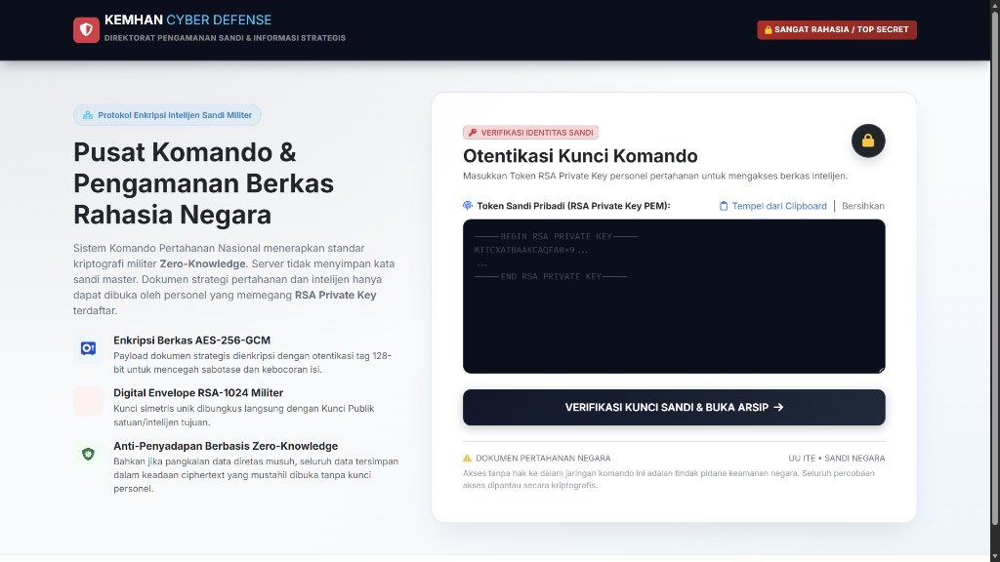

# KEMHAN CYBER DEFENSE — Sistem Pusat Komando Sandi & Berkas Intelijen
### Ujian Tengah Semester (UTS) Mata Kuliah Keamanan Data dan Informasi

Proyek aplikasi web pengamanan berkas intelijen dan dokumen rahasia negara berbasis **PHP Native (tanpa framework eksternal)** yang menerapkan **Kriptografi Hibrida (AES-256-GCM + RSA-1024)**, **Zero-Knowledge Architecture**, dan **Sistem Pertahanan Kamuflase Aktif (Decoy Radar Telemetry)**.

---

## 👤 Identitas Mahasiswa

| Keterangan | Data Mahasiswa |
| :--- | :--- |
| **Nama Lengkap** | **Muhammad Hafizh Akbar Solehudin** |
| **NIM** | **2430511012** |
| **Kelas** | **Teknik Informatika (TI-24A / Reguler)** |
| **Mata Kuliah** | **Keamanan Data dan Informasi** |
| **Dosen Pengampu** | **Asril Adi Sunarto, S.T, M.Kom.** |
| **Program Studi** | Teknik Informatika |
| **Fakultas** | Sains dan Teknologi |
| **Perguruan Tinggi** | Universitas Muhammadiyah Sukabumi (UMMI) |
| **Tahun Akademik** | 2025 / 2026 |
| **Tautan Repositori GitHub** | [https://github.com/hafizhakbar3105/keamanan_data.git](https://github.com/hafizhakbar3105/keamanan_data.git) |

<br>

<p align="center">
  
  <br>
  <em>Gambar: Tampilan Gerbang Otentikasi Kunci Komando KEMHAN Cyber Defense (index.php)</em>
</p>

---

## 🎯 Ringkasan & Penjelasan Sistem

Sistem ini dikembangkan khusus dengan studi kasus pertahanan siber kementerian pertahanan (**KEMHAN CYBER DEFENSE - Pusat Komando Sandi & Berkas Intelijen**) untuk mengatasi kelemahan mendasar pada aplikasi web konvensional:

1. **Mengapa Tanpa Username dan Password? (Zero-Knowledge Architecture)**  
   Pada umumnya, aplikasi web menyimpan *hash* kata sandi di tabel pengguna yang rentan terhadap serangan kebocoran pangkalan data (*credential leak/dump*), *rainbow table attack*, maupun *brute force*. Pada sistem ini, peladen dan basis data **sama sekali tidak menyimpan kredensial administratif master**. Akses komando diberikan murni berdasarkan kepemilikan token kriptografis fisik berupa **Kunci Privat RSA berformat PEM** yang diverifikasi secara matematis menggunakan modul OpenSSL di memori sesi RAM lokal.

2. **Penerapan Enkripsi Hibrida (Hybrid Cryptography):**  
   * **Simetris (AES-256-GCM):** Muatan instruksi strategis dan isi dokumen rahasia dienkripsi secara berkecepatan tinggi menggunakan kunci sesi acak 256-bit dan *Initialization Vector* (IV) 96-bit. Mode GCM memproduksi segel integritas *Authentication Tag* 128-bit untuk mencegah sabotase atau manipulasi bit data (*tamper-proof*).
   * **Asimetris (RSA-1024 Digital Envelope):** Kunci simetris AES dibungkus (*wrapped*) menggunakan Kunci Publik RSA satuan/personel tujuan dokumen. Hanya pihak pemegang Kunci Privat RSA yang bersesuaian yang mampu membuka bungkusan kunci simetris tersebut (*unwrap*) dan membaca teks aslinya.

3. **Prinsip Zero-Plaintext Storage:**  
   Pangkalan data MySQL (`uts_keamanan.data_rahasia`) terbukti **100% menyimpan data dalam keadaan ciphertext terenkripsi Base64**. Sekalipun pihak penyerang berhasil mencuri seluruh berkas fisik basis data melalui SQL Injection atau kebocoran peladen, informasi intelijen tetap aman dan mustahil didekripsi tanpa kunci privat personel.

4. **Sistem Penyamaran Aktif Intelijen (Decoy Honey Camouflage):**  
   Ketika penyerang mencoba masuk menggunakan kunci RSA sembarang, kunci korup, atau token palsu, sistem **TIDAK memunculkan pesan galat (error) 'Access Denied'** yang membocorkan status halaman admin. Sistem secara cerdas mengalihkan antarmuka menjadi monitor telemetri frekuensi radar pasif (`RADAR_NODE_0x77FCFE // PASSIVE_FREQUENCY_TELEMETRY`) dengan seluruh kanal terkunci (`[CARRIER_LOCKED]`), sehingga musuh tertipu dan mengira bahwa peladen ini hanyalah stasiun radio penangkap sinyal mentah yang tidak bernilai.

---

## 🚀 Fitur-Fitur Utama Sistem

* 🛡️ **Zero-Knowledge Gateway (`index.php`):** Otentikasi gerbang masuk tanpa pangkalan data kredensial, memvalidasi integritas matematis RSA Private Key PEM.
* 🔑 **Generator Kunci RSA Rahasia (`buat_kunci.php`):** Utilitas internal untuk administrator menerbitkan pasangan Kunci Privat dan Kunci Publik RSA-1024, dilengkapi fitur *session caching* dan auto-deteksi `openssl.cnf` Windows/Laragon.
* 💻 **Pusat Komando & Dekripsi Real-Time (`admin.php`):** Menampilkan daftar berkas intelijen yang didekripsi secara langsung di memori RAM server saat kunci privat valid dipasangkan. Dilengkapi tombol *Auto-Fill* kunci publik dan pintasan hapus dokumen.
* 📡 **Mode Kamuflase Radar Pasif:** Mengalihkan antarmuka komando menjadi aliran telemetri frekuensi gelombang radar secara transparan saat kunci privat salah/tidak cocok.
* 🔒 **Anti-Tampering Integrity Protection:** Pustaka OpenSSL secara otomatis menolak proses dekripsi jika *Authentication Tag* tidak cocok akibat pengubahan 1 bit karakter ciphertext di basis data.

---

## 📁 Struktur Berkas Proyek

Proyek ini menggunakan arsitektur berkas datar (*flat-file architecture*) murni PHP Native tanpa dependensi eksternal:

```text
uts_keamanan/
│
├── index.php                         # Gerbang masuk otentikasi Zero-Knowledge (Input Kunci Privat RSA)
├── buat_kunci.php                    # Utilitas internal generator pasangan kunci RSA-1024
├── admin.php                         # Ruang kendali komando (Dekripsi Real-Time & Mode Penyamaran Radar)
├── database.php                      # Koneksi MySQLi dengan auto-provisioning database & tabel otomatis
├── database.sql                      # Skema DDL tabel data_rahasia (Penyimpanan Zero-Plaintext)
│
├── LAPORAN_PRAKTIKUM_UTS_2430511012.docx # Laporan praktikum lengkap format Microsoft Word (Font TNR 12pt, Spasi 1.5)
├── LAPORAN_PRAKTIKUM_UTS.html        # Dokumen laporan siap cetak ke PDF A4 (Ctrl + P)
├── LAPORAN_PRAKTIKUM_UTS.md          # Dokumen laporan format Markdown terstruktur
│
├── logo_ummi.png                     # Lambang resmi Universitas Muhammadiyah Sukabumi
├── img_buat_kunci.jpg                # Tangkapan layar generator pasangan kunci RSA-1024
├── img_login.jpg                     # Tangkapan layar gerbang otentikasi kunci komando KEMHAN
├── img_admin_valid.jpg               # Tangkapan layar antarmuka arsip intelijen saat kunci privat valid
├── img_admin_decoy.jpg               # Tangkapan layar antarmuka radar telemetri pasif (Decoy Camouflage)
└── README.md                         # Dokumentasi lengkap proyek dan identitas pengembang
```

---

## 🛠️ Persyaratan Lingkungan & Instalasi

### 1. Prasyarat Sistem
* **Web Server:** Laragon / XAMPP dengan Apache 2.4+
* **PHP:** PHP 8.0, 8.1, 8.2, 8.3, atau 8.4+ (dengan ekstensi `openssl` dan `mysqli` aktif)
* **Basis Data:** MySQL 8.0+ / MariaDB 10.4+
* **Sistem Operasi:** Windows 10/11, Linux, atau macOS

### 2. Langkah Menjalankan Aplikasi
1. Buka folder instalasi Laragon Anda (misalnya `C:\laragon\www\`).
2. Pastikan repositori ini berada di direktori:
   ```text
   C:\laragon\www\uts_keamanan
   ```
3. Buka panel kontrol **Laragon** dan klik tombol **Start All** (menjalankan Apache & MySQL).
4. Basis data dan tabel pangkalan data akan **dibuat secara otomatis oleh sistem** saat pertama kali aplikasi dibuka melalui file `database.php` (*auto-provisioning*).

---

## 📖 Alur Kerja & Pengujian Sistem

1. **Membuat Pasangan Kunci RSA-1024:**
   * Buka peramban web dan akses: `http://localhost/uts_keamanan/buat_kunci.php` (atau `http://localhost:8081/uts_keamanan/buat_kunci.php`).
   * Salin **Kunci Privat (Private Key)** untuk keperluan login dan dekripsi.
   * Salin **Kunci Publik (Public Key)** untuk keperluan enkripsi dokumen baru.

2. **Login Otentikasi Komando (Zero-Knowledge):**
   * Buka gerbang masuk: `http://localhost/uts_keamanan/index.php`.
   * Tempelkan teks Kunci Privat PEM Anda pada formulir, lalu klik **Verifikasi Kunci Sandi & Buka Arsip**.
   * Jika format kunci privat valid, Anda akan langsung dialihkan ke Ruang Kendali Komando (`admin.php`).

3. **Mengenkripsi Dokumen Intelijen Baru:**
   * Pada panel kiri `admin.php`, masukkan Klasifikasi/Judul Operasi dan Instruksi Strategis (Plaintext).
   * Masukkan Kunci Publik RSA tujuan (atau klik tombol **Auto-Fill Kunci Saya**).
   * Klik **Enkripsi & Amankan ke Brankas**.
   * Dokumen akan seketika dienkripsi dengan AES-256-GCM, kunci simetrisnya dibungkus RSA, lalu paket ciphertext tersimpan di MySQL.

4. **Pengujian Mode Penyamaran Radar (Decoy Camouflage):**
   * Klik tombol **Tutup Akses Komando** untuk logout.
   * Pada halaman login `index.php`, masukkan teks kunci sembarang atau token kunci yang korup/palsu.
   * Sistem secara otomatis mengaktifkan mode penyamaran militer **RADAR_NODE_0x... // PASSIVE_FREQUENCY_TELEMETRY**, seluruh dokumen terkunci dalam status `[CARRIER_LOCKED]`, dan tidak ada data rahasia maupun identitas portal admin yang bocor ke penyusup.

---

## 📚 Dokumen Laporan Praktikum UTS

Untuk keperluan pengumpulan tugas Ujian Tengah Semester (UTS), laporan lengkap telah disusun mengikuti standar akademik UMMI:
* **Format Microsoft Word:** `LAPORAN_PRAKTIKUM_UTS_2430511012.docx` (Font Times New Roman 12pt, 1.5 spasi, margin akademik A4, sitasi Mendeley APA 7th Edition).
* **Format PDF / Cetak:** `LAPORAN_PRAKTIKUM_UTS.html` (Buka pada browser lalu tekan `Ctrl + P` untuk cetak/simpan PDF).
* **Format Markdown:** `LAPORAN_PRAKTIKUM_UTS.md`.

---

© 2026 **Muhammad Hafizh Akbar Solehudin (2430511012)** — Program Studi Teknik Informatika, Fakultas Sains dan Teknologi, Universitas Muhammadiyah Sukabumi (UMMI).
